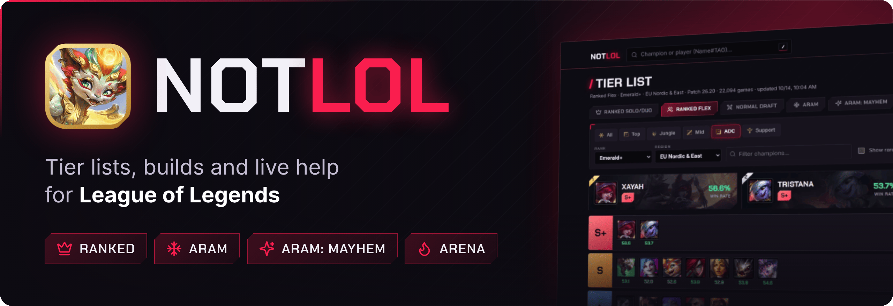
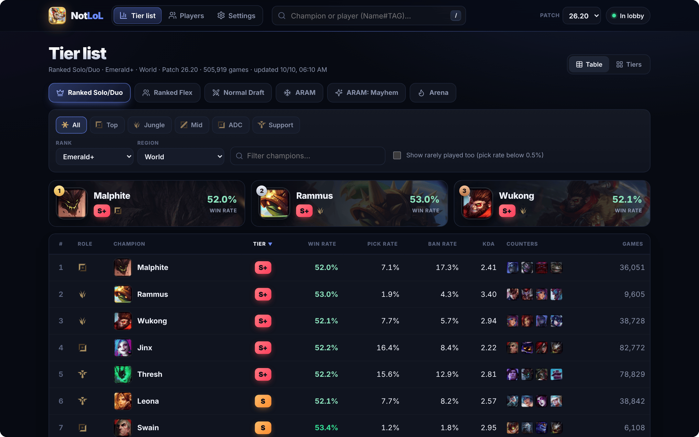
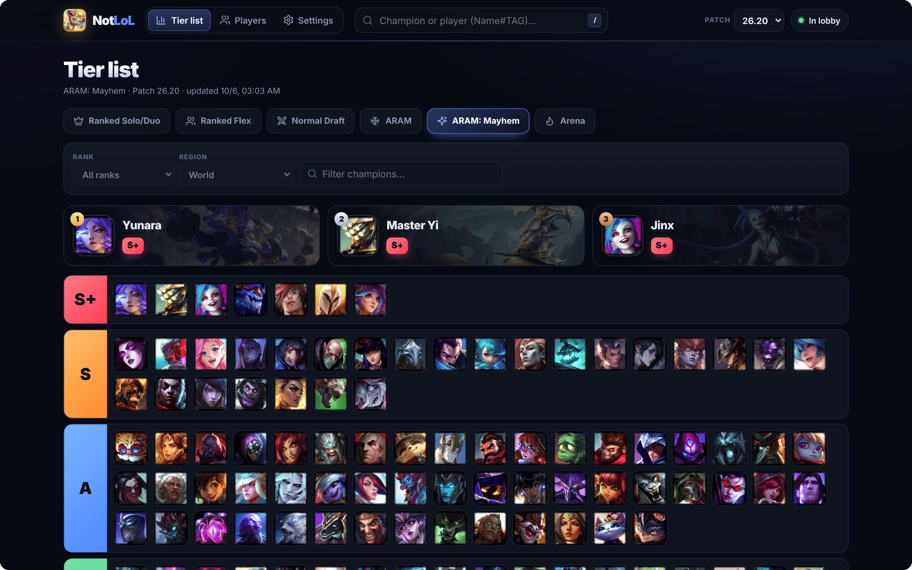
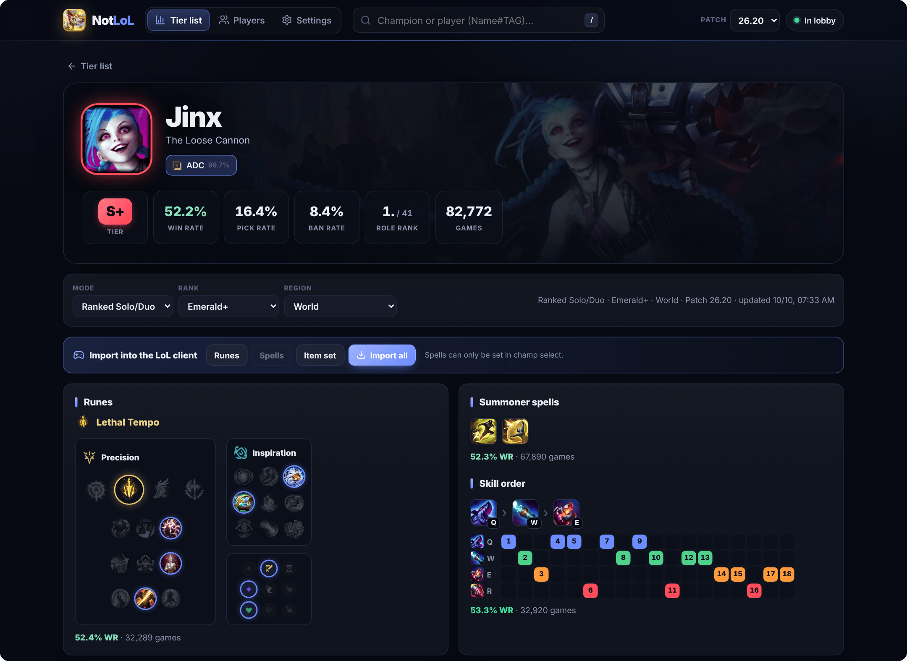
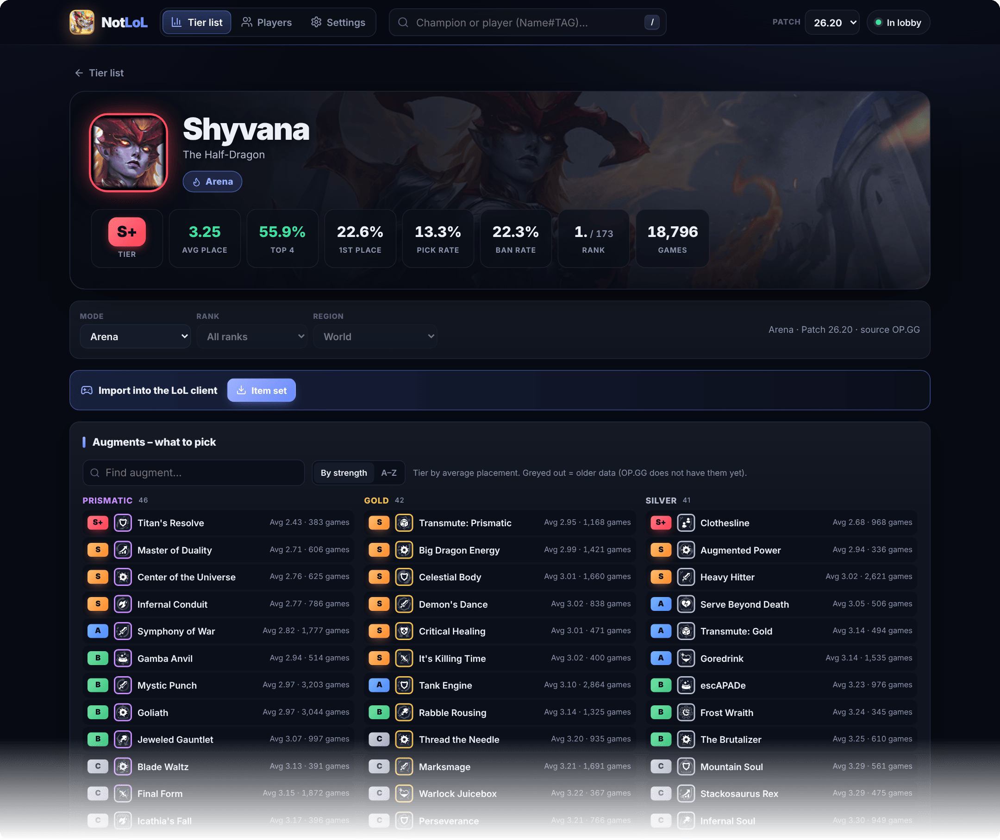
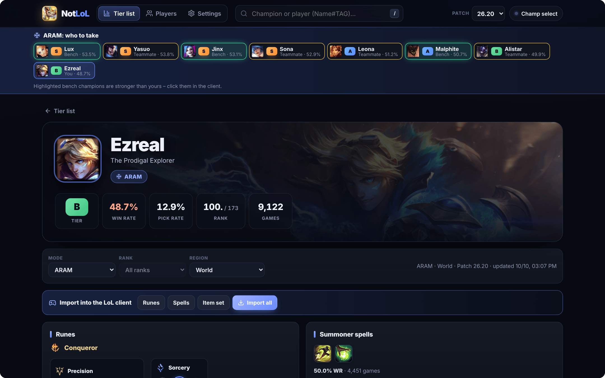
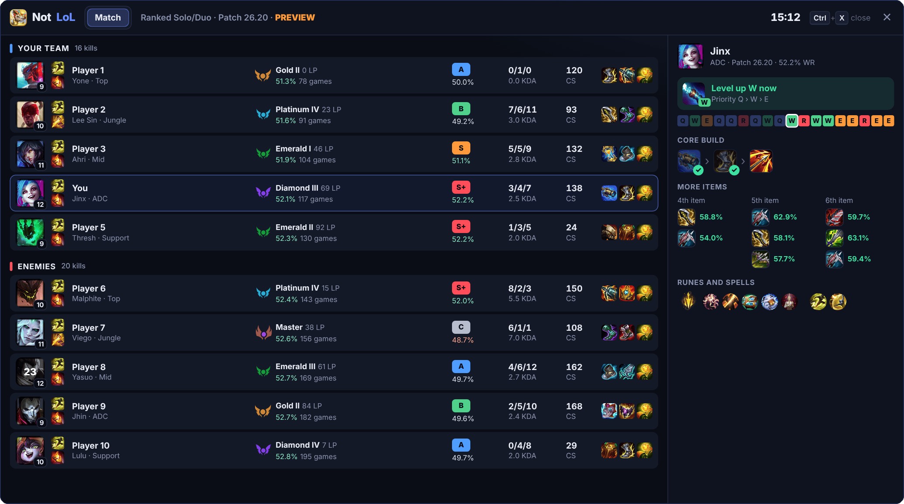
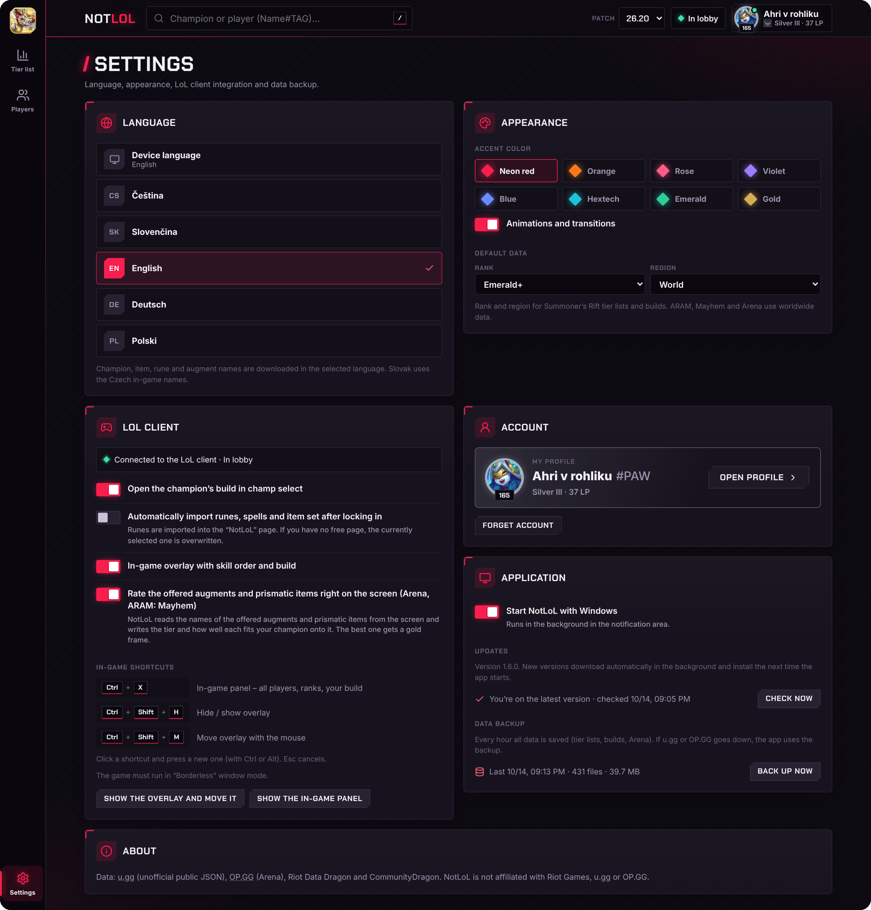

  

  

  
  
  
  

  <b>The newest tier lists and builds for every mode, one-click imports into your client and help right inside the game – all in one small Windows app.</b>

  <a href="#-whats-inside">What's inside</a> ·
  <a href="#-install">Install</a> ·
  <a href="#-in-game-shortcuts">Shortcuts</a> ·
  <a href="#-faq">FAQ</a>

## ✨ What's inside

### 📊 A tier list for every mode

Ranked Solo/Duo, Flex, Normal Draft, ARAM, ARAM: Mayhem and Arena – always for the newest patch. Pick your rank and region, sort by win rate, pick rate or ban rate, see who counters whom, or switch to the classic tier view.

### 🧩 Builds, runes and matchups – imported in one click

Every champion comes with runes, summoner spells, skill order, starting items, the core build and the matchups you win and lose. Hit **Import all** and the runes, spells and item set land straight in your LoL client – or let NotLoL do it on its own the moment you lock in.

### 🔥 Arena and ARAM: Mayhem

See which augments to take with your champion, ranked from best to worst. In Arena you also get the top 10 prismatic items and the best duo partners.

### 🎯 Help in champ select

NotLoL opens your champion's build as soon as you pick it. In ARAM it shows whether a bench champion or a teammate's pick is stronger than yours, in Arena how well you do with your partner.

### 🎮 In the game

- A small **overlay** tells you which ability to level up next and shows your build, ticking off the items you've already bought.
- <kbd>Ctrl</kbd> + <kbd>X</kbd> opens a **panel with every player** in the match – rank, account level, form in their last 20 games, how often they play their champion, runes, KDA, items and how strong their champion is – next to your full build.
- In **Arena and ARAM: Mayhem**, NotLoL rates the augments and prismatic items you're offered **right on the cards**: the tier, how well each one fits your champion, and a gold frame around the best pick.

### ⚙️ Stays out of your way

NotLoL starts quietly with Windows and waits in the tray, updates itself, speaks Czech, Slovak, English, German and Polish, and comes in six accent colors. It keeps an hourly backup of all its data, so it keeps working even when a data source goes down. You can also look up any player by Riot ID and click any match in their history to see every player's damage, gold, CS, vision and items. Your own profile sits in the top right corner.

## 📥 Install

1. **[Download NotLoL-Setup.exe](https://github.com/NotTerraCZ/NotLoL/releases/latest/download/NotLoL-Setup.exe)**
2. Run it. Windows may say *"Windows protected your PC"* because the app isn't signed – click **More info → Run anyway**.
3. Start League of Legends. NotLoL connects to the client by itself.

That's it – no account and no sign-up. If your PC is missing the .NET 10 Desktop Runtime or WebView2, the installer installs it for you.

**Updates are automatic.** NotLoL downloads new versions in the background and installs them the next time it starts. Want the new version right away? Click **Update** in the top right corner.

> [!TIP]
> For the overlay and the in-game panel, set the game to **Borderless** window mode (in-game *Settings → Video → Window Mode*).

## ⚡ In-game shortcuts

| Shortcut | What it does |
| --- | --- |
| <kbd>Ctrl</kbd> + <kbd>X</kbd> | In-game panel – all players, ranks, your build |
| <kbd>Ctrl</kbd> + <kbd>Shift</kbd> + <kbd>H</kbd> | Hide / show the overlay |
| <kbd>Ctrl</kbd> + <kbd>Shift</kbd> + <kbd>M</kbd> | Move the overlay with the mouse |

## ❓ FAQ

<b>Is it free?</b>

 
Yes. No ads, no account, nothing to pay.

<b>Can I get banned for using it?</b>

 
NotLoL doesn't touch the game's files or memory. It talks to the LoL client and the game only through their official local interfaces – the same ones apps like u.gg or Blitz use – and it reads the augment cards from the screen, just like a screenshot. Still, it's a fan project that isn't endorsed by Riot Games, so use it at your own risk.

<b>Where does the data come from?</b>

 
Tier lists, builds, runes and matchups come from <a href="https://u.gg">u.gg</a>, Arena data from <a href="https://op.gg">OP.GG</a>, and names and icons from Riot's Data Dragon and CommunityDragon. NotLoL always shows the newest patch, and you can switch to older ones in the top bar.

<b>The overlay doesn't show up in the game.</b>

 
Switch the game to <b>Borderless</b> window mode – Windows doesn't draw other apps over a game in exclusive fullscreen. Also check that the overlay is turned on in NotLoL's settings, and press <kbd>Ctrl</kbd> + <kbd>Shift</kbd> + <kbd>H</kbd> in case you hid it.

<b>Why can't I find a player?</b>

 
Player search goes through your LoL client, so the client has to be running, and it only finds players on the server you're logged in to.

<b>How do I change the language?</b>

 
NotLoL follows your Windows language. You can pick a different one in <i>Settings → Language</i>.

<b>How do I uninstall it?</b>

 
Open Windows <i>Settings → Apps</i>, find NotLoL and click <b>Uninstall</b>. This also removes NotLoL's settings and saved data.

---

NotLoL isn't endorsed by Riot Games and doesn't reflect the views or opinions of Riot Games or anyone officially involved in producing or managing Riot Games properties. Riot Games, and all associated properties are trademarks or registered trademarks of Riot Games, Inc. NotLoL is not affiliated with u.gg or OP.GG.

Want to build NotLoL yourself or release a new version? See [DEVELOPMENT.md](DEVELOPMENT.md).
